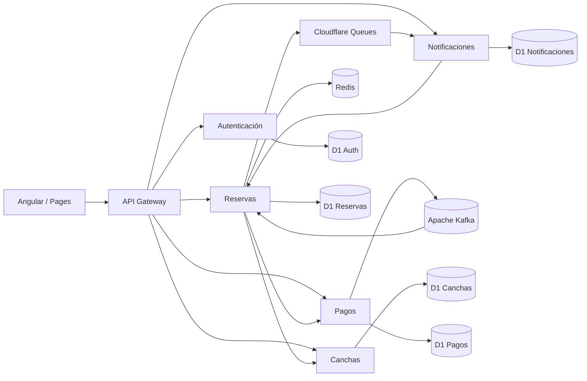
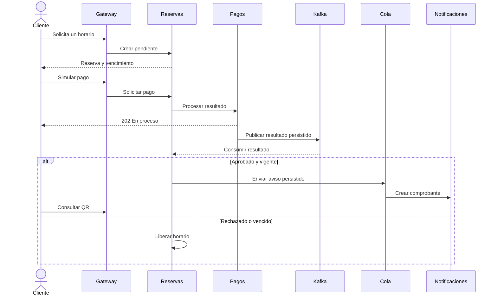

# Arquitectura académica

La propuesta inicial de GoDeporte para Taller de Desarrollo define cinco servicios, una retención temporal, aprobación simulada y comprobante. El plan actualizado concreta Angular, seis Workers contando el Gateway, cinco bases D1, Redis, Kafka y una cola.

| Servicio | Responsabilidad |
| --- | --- |
| Auth | Registro, contraseñas derivadas con PBKDF2, JWT y roles. |
| Canchas | Catálogo, tarifas por hora y horas de atención. |
| Reservas | Disponibilidad, expiración, transiciones e ingreso. |
| Pagos | Un resultado simulado por reserva y publicación recuperable. |
| Notificaciones | Consumo de avisos, comprobante y render del QR. |

- **RN-01.** El índice único parcial en D1 cubre la cancha, fecha y hora de toda reserva activa. La actualización del vencimiento y el alta se ejecutan juntas. Redis mantiene una llave temporal de apoyo. D1 mantiene la exclusividad durante una caída de Redis.
- **RN-02 y RN-03.** Las franjas duran una hora, se expresan en hora peruana y la solicitud vence en 600 segundos. Disponibilidad excluye las pendientes vencidas y el alta puede reutilizar su horario en la misma transacción.
- **RN-04.** El consumidor aplica una transición condicional únicamente si la reserva sigue pendiente y vigente. La repetición de un evento no vuelve a cambiar el estado. Un rechazo libera el horario.
- Pagos conserva los resultados que Kafka aún no confirmó. El cron reintenta y puede producir duplicados tras un fallo entre la confirmación de Kafka y la escritura local.
- Un trigger escribe el aviso junto con la confirmación. La cola reintenta y conserva agotados en la DLQ. El consumidor genera un comprobante por reserva. La validación de ingreso y la cancelación compiten sobre la misma fila en Reservas.
- En local el puente KafkaJS publica y consume el broker en tiempo real. En Cloudflare se usa Karapace mediante HTTPS y el consumidor de Reservas se ejecuta por cron.
