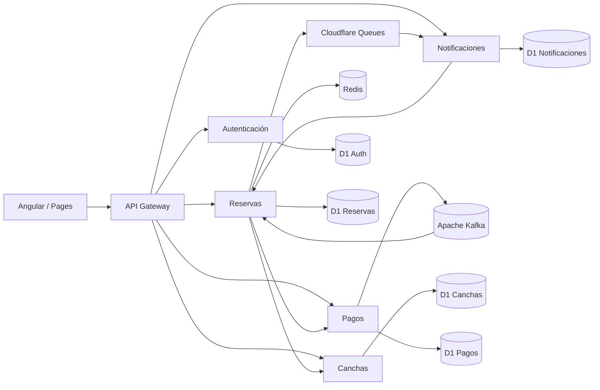
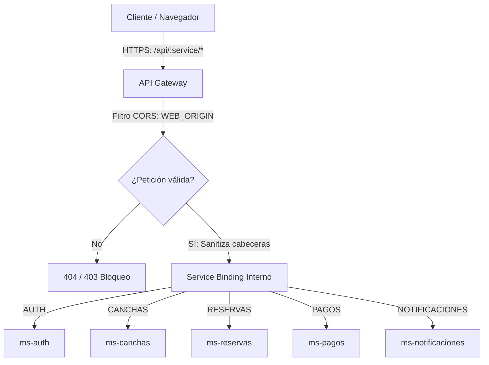
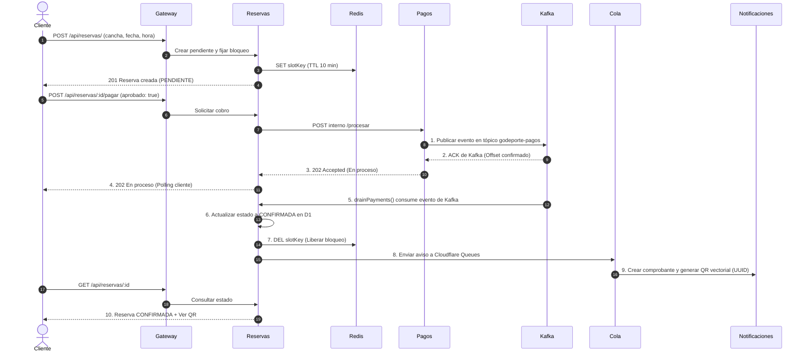

# Arquitectura del Sistema GoDeporte

La propuesta técnica de GoDeporte implementa una arquitectura orientada a microservicios (*Database-per-Service*) y dirigida por eventos (*Event-Driven Architecture*). El sistema está compuesto por una aplicación web en Angular (Cloudflare Pages), un API Gateway perimetral, cinco microservicios desacoplados sobre Cloudflare Workers, cinco bases de datos SQLite distribuidas (Cloudflare D1), caché en memoria (Redis), bus de eventos (Apache Kafka) y una cola asíncrona (Cloudflare Queues).



## Servicios y responsabilidades

| Servicio | Responsabilidad | Almacenamiento / Integración |
| --- | --- | --- |
| **API Gateway** | Punto de entrada unificado, enrutamiento por *Service Bindings*, CORS y seguridad perimetral. | En memoria (Cloudflare Worker) |
| **Auth** | Registro, credenciales derivadas con PBKDF2, emisión/verificación de JWT y control de roles (`cliente`, `admin`). | D1 Auth (`usuarios`) |
| **Canchas** | Catálogo de recintos deportivos, tarifas por hora y horarios de atención (apertura/cierre). | D1 Canchas (`canchas`) |
| **Reservas** | Control de disponibilidad, bloqueo temporal de franjas, transiciones de estado y validación de ingreso. | D1 Reservas (`reservas`) + Redis |
| **Pagos** | Simulación y procesamiento de pagos con idempotencia por reserva y publicación garantizada en Kafka. | D1 Pagos (`pagos`) + Apache Kafka |
| **Notificaciones** | Consumo asíncrono de eventos de confirmación, emisión de comprobantes y renderizado vectorial de QR. | D1 Notificaciones (`comprobantes`) + Cloudflare Queues |

---

## Configuración y funcionamiento del API Gateway

El **API Gateway** actúa como el único punto de contacto público entre los clientes (web y móviles) y el ecosistema de microservicios:



1. **Enrutamiento por Service Bindings:** El Gateway no realiza llamadas HTTP públicas salientes hacia los microservicios. Utiliza *Service Bindings* de Cloudflare Workers, lo que permite invocar el código de cada microservicio en la red interna de Cloudflare con latencia de memoria cero y sin exponer los servicios a internet.
2. **Aislamiento de rutas privadas y sanitización:**
   - **Rutas bloqueadas:** Rutas internas como `/eventos`, `/interno` o llamadas directas de procesamiento de pagos (`/procesar`) están denegadas desde el Gateway (`404 Ruta interna`). Solo los Workers autorizados pueden comunicarse internamente entre sí.
   - **Protección de cabeceras:** Se elimina cualquier cabecera `X-Internal-Key` enviada desde el exterior, impidiendo que clientes maliciosos suplanten llamadas inter-servicio.
3. **Control de CORS centralizado:** Aplica políticas estrictas de Cross-Origin Resource Sharing restringidas únicamente al origen autorizado `WEB_ORIGIN` (`https://godeporte.pages.dev`), admitiendo métodos `GET, POST, PUT, OPTIONS` y cabeceras `Authorization, Content-Type`.
4. **Endpoints de diagnóstico:**
   - `GET /`: Retorna el estado operativo del Gateway, versión y catálogo de servicios vinculados.
   - `GET /health`: Comprobación de salud estandarizada (`{"estado":"UP","servicio":"gateway"}`).

---

## Flujo de reservas, pagos y emisión de comprobantes



---

## Reglas de negocio y mecanismos arquitectónicos

### RN-01. Exclusión de horarios y concurrencia
* **Índice parcial único en D1:** La tabla `reservas` cuenta con un índice único parcial sobre `(cancha, fecha, hora)` aplicable a reservas activas (`estado IN ('PENDIENTE', 'CONFIRMADA')`). Esto garantiza a nivel de base de datos que dos transacciones simultáneas jamás reserven la misma franja.
* **Bloqueo distribuido en Redis:** Redis almacena llaves temporales con TTL para respuesta ultrarrápida en consultas de disponibilidad. Si Redis sufre una caída transitoria, D1 mantiene la exclusividad sin corrupción de datos.

### RN-02 y RN-03. Franjas y expiración
* Las franjas deportivas duran 600 segundos (10 minutos) en estado `PENDIENTE`.
* Si no se registra pago antes del vencimiento, la reserva expira automáticamente y la consulta de disponibilidad libera la franja para otro usuario.

### RN-04. Desacoplamiento total y mensajería orientada a eventos (Kafka + Redis)
* **Persistencia y publicación obligatoria:** `ms-pagos` guarda la transacción en `D1 Pagos` con `publicado = 0` y la envía al tópico `godeporte-pagos`. Solo tras recibir el ACK con el `offset` de Kafka, actualiza a `publicado = 1` y retorna `202 En proceso`. No hay notificación directa a `ms-reservas`.
* **Afinidad de nodo y consumo serverless:** `ms-reservas` resuelve el balanceo multikernel de Aiven Karapace conectando directamente a la `base_uri` retornada por el broker, eliminando errores 40403 y leyendo los eventos del tópico de forma inmediata.
* **Consumidor e idempotencia estricta:** `drainPayments()` procesa los mensajes del tópico `godeporte-pagos` y ejecuta `applyPayment()`: si el estado continúa en `PENDIENTE`, actualiza a `CONFIRMADA`, libera la clave de bloqueo en Redis (`DEL slotKey`) y dispara el aviso hacia Cloudflare Queues. Si un evento se recibe repetido, la condición atómica descarta el duplicado sin efectos colaterales.

### RN-05. Emisión de comprobantes y QR vectorial
* El microservicio `Notificaciones` consume los avisos de la cola `godeporte-academico-avisos`.
* Inserta de manera idempotente un comprobante con un código UUID único (`comprobantes`).
* Genera la imagen del código QR en formato vectorial **SVG embebido en base64**, eliminando almacenamiento pesado de archivos y dependencias externas. La URL codificada en el QR es:
  ```
  https://godeporte.pages.dev/#ingreso=<uuid-comprobante>
  ```

### RN-06. Validación de ingreso (Control de acceso)
* El personal con rol `admin` puede escanear el código QR directamente con la cámara del dispositivo móvil (que abre la URL con el hash `#ingreso`) o ingresar el enlace manualmente en la pestaña *Validar ingreso*.
* La aplicación Angular detecta el parámetro hash y precarga el código en el formulario.
* Al pulsar *Registrar ingreso*, se invoca `POST /api/notificaciones/validar/:codigo`.
* `ms-notificaciones` valida las credenciales administrativas y consulta internamente a `ms-reservas` vía `POST /interno/:id/ingreso`.
* `ms-reservas` ejecuta una actualización atómica:
  ```sql
  UPDATE reservas SET ingreso = unixepoch()
  WHERE id = ? AND estado = 'CONFIRMADA' AND ingreso IS NULL
  RETURNING cancha, fecha, hora, usuario;
  ```
* **Prevención de reingreso y fraude:** Si el código ya fue utilizado o la reserva no está confirmada, la consulta no retorna registros y el sistema responde inmediatamente con código **HTTP 409 (*Conflict*)**, informando al administrador que el código ya fue utilizado.

---

## Optimización de interfaz y experiencia de usuario (UX)

1. **Carga ultrarrápida del catálogo (SSR + SWR):** El catálogo de canchas se inyecta estáticamente en el HTML inicial para evitar pantallas en blanco, refrescando su estado en segundo plano mediante *Stale-While-Revalidate*.
2. **Calendario integrado nativo:** Reemplazo de selectores de fecha del navegador por un calendario integrado en español con navegación mes a mes, garantizando visualización consistente en móviles y escritorio.
3. **Flujo de reserva no destructivo:** Tocar una franja horaria únicamente la selecciona visualmente; la reserva se materializa solo tras pulsar el botón *Reservar* y confirmar en un diálogo modal accesible.
4. **Roles segregados:** La cuenta administradora dispone de vistas dedicadas para *Validar ingreso*, *Dashboard* (monitoreo de todas las reservas del sistema), *Administrar* (alta y edición de canchas) y *Mis reservas* (gestión de reservas personales).
